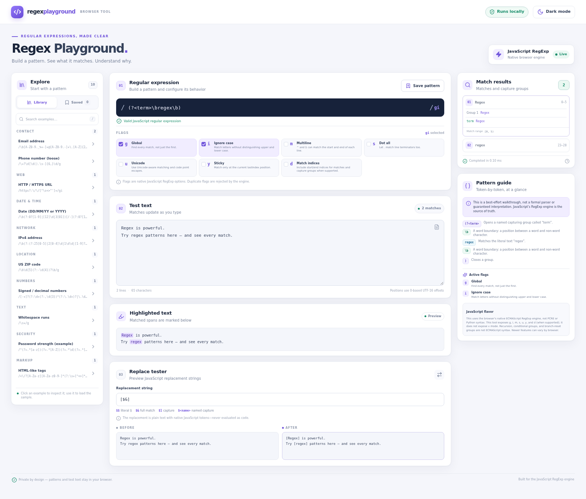
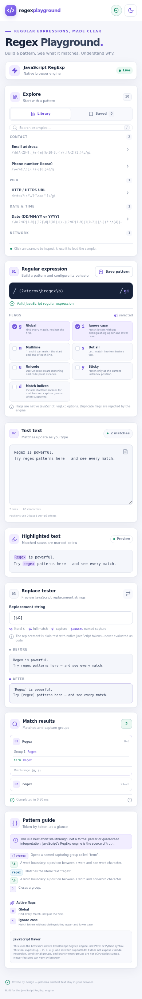
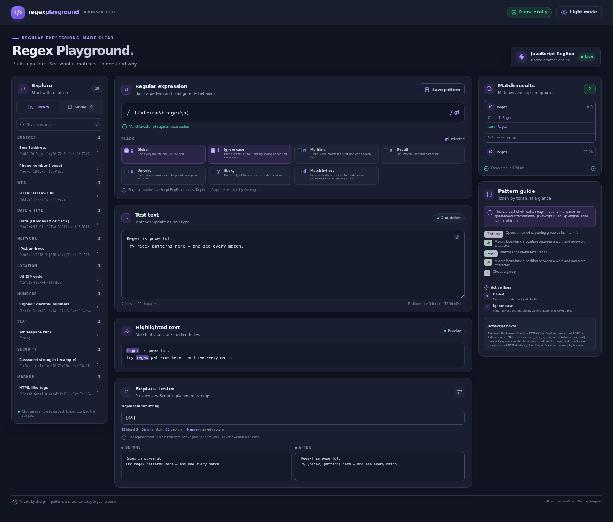

# Regex Playground

Regex Playground is a browser-only workspace for writing, testing, explaining, and saving **JavaScript regular expressions**. It brings live match highlighting, capture inspection, replacement previews, a token guide, and a curated example library into one responsive developer-focused interface.

> This is a learning and testing aid—not a complete regular-expression parser, a security validator, or a substitute for testing against your production data.

## Live demo

**Live demo:** [https://majidramzi.github.io/regex-playground/](https://majidramzi.github.io/regex-playground/)  
The URL will be live after the repository's GitHub Pages deployment workflow has run successfully.

## Screenshots

The screenshots below were captured from the running app at desktop and mobile viewport sizes.

| Desktop workspace — light | Mobile workspace |
| --- | --- |
|  |  |

Dark theme, captured at the same desktop viewport:



The captures show the live match inspector, highlighted text, replacement preview, and responsive single-column mobile layout. Use the theme control in the app to switch between light and dark themes.

## Features

- **Live tester:** edit a pattern and test text and see native JavaScript matches update automatically.
- **Match highlighting:** inspect every match in context, including visible markers for zero-width matches.
- **Match details:** see match text, 0-based start/end positions, numbered and named capture groups, and capture indices when `d` is supported and enabled.
- **Seven flag controls:** toggle `g`, `i`, `m`, `s`, `u`, `y`, and `d` individually; `d` is disabled when the current browser does not support it.
- **Replace tester:** compare before/after output using JavaScript replacement references such as `$&`, `$1`, `$<name>`, and `$$`. Replacement input is treated as text, never evaluated as code.
- **Best-effort pattern guide:** view color-coded token notes for common escapes, classes, groups, assertions, anchors, alternation, and quantifiers. The guide explicitly does not claim to be a complete parser.
- **Pattern library:** inspect and load examples for email-shaped text, URLs, phone numbers, dates, IPv4 addresses, US ZIP codes, numbers, whitespace, password-policy teaching examples, and HTML-like tags. Each example includes an explanation, sample input, and expected matches.
- **Saved patterns:** save, edit, load, and delete named patterns in local browser storage. Import and export them as JSON.
- **Light and dark themes:** theme choice is remembered locally when browser storage is available.
- **Responsive layout:** the workspace moves from a three-column desktop view to tablet and mobile layouts.
- **Worker-isolated analysis:** matching runs in a disposable Web Worker. A time limit, input/pattern limits, and a match cap reduce the risk that an expensive expression locks up the interface.
- **No backend, account, analytics, or external API.**

## Regex examples

Patterns below are **JavaScript regex source** (without `/.../` delimiters). They are useful starting points, not universal validators.

| Use | Pattern | Notes |
| --- | --- | --- |
| Email-shaped text | `\b[A-Z0-9._%+-]+@[A-Z0-9.-]+\.[A-Z]{2,}\b` (`gi`) | Practical matching only; not full RFC validation. |
| HTTP(S) URL | `https?:\/\/[^\s<>"']+` (`gi`) | Stops at whitespace and common delimiters; URL parsing is a separate job. |
| IPv4 address | `\b(?:(?:25[0-5]|2[0-4]\d|1\d\d|[1-9]?\d)\.){3}(?:25[0-5]|2[0-4]\d|1\d\d|[1-9]?\d)\b` (`g`) | Checks four octets in the range 0–255, not network validity. |
| Unicode letters | `\p{Letter}+` (`gu`) | Unicode property escapes require `u`. |
| Named capture | `(?<user>\w+)@(?<host>[\w.-]+)` (`i`) | Named groups are available in modern JavaScript engines. |

The in-app library contains complete, runnable sample inputs and expected matches for each of its ten examples.

## JavaScript RegExp support and limitations

The playground uses the browser's built-in `RegExp` constructor and `String.prototype.replace`; it does not translate patterns from another regex dialect. The flag controls exposed by this project are:

| Flag | JavaScript behavior |
| --- | --- |
| `g` | Find all non-overlapping matches. |
| `i` | Case-insensitive matching. |
| `m` | Make `^` and `$` work at line boundaries as well as input boundaries. |
| `s` | Make `.` include line terminators. |
| `u` | Enable Unicode-aware matching and Unicode code-point/property escapes. |
| `y` | Sticky matching at the current `lastIndex`. |
| `d` | Add match and capture-group index ranges; browser support varies. |

Common supported syntax includes character classes, shorthand escapes, anchors, greedy/lazy quantifiers, numbered and named captures, backreferences, non-capturing groups, lookaheads, and lookbehinds in engines that support them. Unicode property escapes require `u`. Exact syntax support is determined by the browser running the app.

This tool intentionally does not expose the newer `v` flag. ECMAScript regular expressions are not PCRE, Python, or .NET regexes; syntax such as recursive patterns, conditional groups, and branch-reset groups is not part of ECMAScript. Do not assume that a pattern copied from another engine will behave the same way. The token guide is intentionally best-effort and not a formal parse.

### Performance and safety

Some backtracking expressions can take a very long time on certain inputs. Analysis runs in a worker that the page can terminate after a short timeout, keeping the main interface responsive. The app also caps patterns at 2,048 characters, test text at 100,000 characters, and returned matches at 2,000. These safeguards reduce risk but do not make arbitrary regular expressions universally safe. Be careful with untrusted patterns and large inputs.

## Technology stack

- React 19 and TypeScript
- Vite
- Tailwind CSS (with a small custom design system)
- Lucide React icons
- Native JavaScript `RegExp` and Web Workers
- Vitest, jsdom, React Testing Library, and jest-dom
- GitHub Actions and GitHub Pages

## Installation

Requirements: Node.js 20 or later and npm.

```bash
git clone https://github.com/majidramzi/regex-playground.git
cd regex-playground
npm ci
```

## Development

Start the Vite development server:

```bash
npm run dev
```

Vite prints the local URL (usually `http://localhost:5173`). The app requires no backend or environment variables.

## Testing

Run the unit and library tests:

```bash
npm test
```

Run Vitest in watch mode while developing:

```bash
npm run test:watch
```

The test suite covers valid/invalid syntax, flags, global and sticky behavior, capture groups, replacement references, empty input and zero-width matches, special characters, Unicode, match indices where supported, import/export validation, and all bundled examples.

## Type checking and production build

```bash
npm run typecheck
npm run build
```

The production output is written to `dist/`. Preview the production build locally with:

```bash
npm run preview
```

## Deployment to GitHub Pages

The repository is configured for the project site path `/regex-playground/` in `vite.config.ts`. The workflow at `.github/workflows/deploy.yml` runs on pushes to `main` and on manual dispatch. It installs dependencies, type-checks, runs tests, builds the site, then publishes `dist/` to GitHub Pages.

To enable deployment in a GitHub repository:

1. Push the project to a repository named `regex-playground` under the expected owner.
2. In **Settings → Pages**, choose **GitHub Actions** as the build and deployment source.
3. Push to `main` (or run the workflow manually) and wait for the deployment job to finish.
4. Visit `https://majidramzi.github.io/regex-playground/`.

If you fork this project under a different owner or repository name, update the `base` value in `vite.config.ts` and the deployment URL in this README.

## Privacy

All matching, highlighting, explanation, and replacement work runs locally in your browser. Saved patterns and theme choice are stored in that browser's `localStorage`. Nothing is uploaded by the app. Exporting JSON creates a file on your device; importing JSON reads it locally. Clearing site data removes locally saved patterns and theme preference.

## Project structure

```text
.
├── .github/workflows/deploy.yml  # Test, build, and GitHub Pages deployment
├── index.html                    # Vite entry document
├── src/
│   ├── components/               # Editor, flags, results, library, and panels
│   ├── hooks/                    # Worker analysis and saved-pattern state
│   ├── test/                     # Vitest setup
│   ├── utils/                    # RegExp analysis, pattern data, storage, types
│   ├── workers/                  # Disposable RegExp analysis worker
│   ├── App.tsx
│   ├── main.tsx
│   └── styles.css
├── tailwind.config.js
├── tsconfig.json
└── vite.config.ts
```

## Contributing

Issues and pull requests are welcome. Before opening a pull request:

1. Keep browser-only behavior and JavaScript RegExp semantics explicit.
2. Add or update tests for behavior changes, especially flags, Unicode, zero-width matches, and replacements.
3. Do not add network services or evaluate user-provided JavaScript.
4. Run `npm run typecheck`, `npm test`, and `npm run build`.
5. Describe any browser-specific limitations in the UI or documentation.

## License

Released under the [MIT License](LICENSE).
